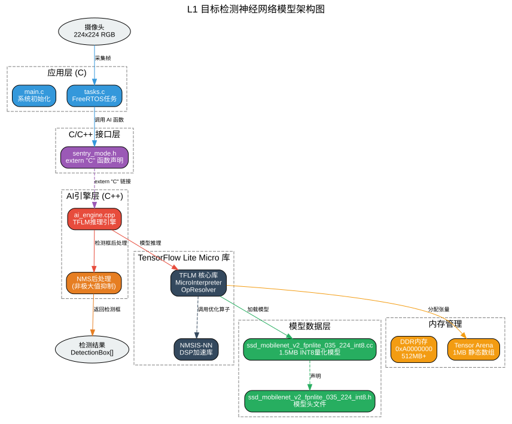

# 哨兵功能神经网络模型集成记录

## 1. 项目概述

### 1.1 目标
为车载哨兵模式视觉监控系统（sentry_mode_rtos）集成 L1 目标检测 AI 模型（SSD MobileNet v2 FPN-lite），替换原有的 mock AI 引擎实现，使用真实的 TensorFlow Lite Micro (TFLM) 推理。

### 1.2 硬件平台
- **CPU**: Nuclei N900FD (32位 RISC-V)
- **内存**: 
  - ILM: 64KB (代码和Level 1模型)
  - DLM: 64KB (任务栈和缓冲区)
  - DDR: 512MB+ (Level 2模型、视频缓冲)
- **外设**: 摄像头、SD卡、蜂鸣器、4G/WiFi模块(可选)

### 1.3 软件架构
```
src/
├── main.c              # 主程序入口，任务创建
├── tasks.c             # FreeRTOS任务实现
├── memory_manager.c    # DDR内存管理和模型加载
├── ai_engine.cpp       # TFLite Micro封装 (C++)
├── hal.c              # 硬件抽象层
├── storage.c          # FatFs文件系统操作
└── inc/
    └── sentry_mode.h  # 主头文件
```

### 1.4 L1 神经网络模型架构



**架构说明：**

1. **应用层 (C)**：`tasks.c` 中的 FreeRTOS 任务调用 AI 函数
2. **C/C++ 接口层**：`sentry_mode.h` 通过 `extern "C"` 实现 C 和 C++ 的桥接
3. **AI引擎层 (C++)**：`ai_engine.cpp` 封装 TFLM 推理逻辑，包含 NMS 后处理
4. **TFLM 库层**：TensorFlow Lite Micro 核心库，负责模型加载和推理
5. **模型数据层**：INT8 量化的 SSD MobileNet v2 模型数据（1.5MB）
6. **内存管理层**：Tensor Arena（1MB 静态数组）用于张量分配

## 2. 模型选择

### 2.1 模型信息
- **模型名称**: SSD MobileNet v2 FPN-lite 0.35×
- **输入尺寸**: 224×224×3 (RGB)
- **量化方式**: INT8
- **训练数据集**: COCO 2017 (person类别)
- **模型大小**: ~1.5MB
- **来源**: nuclei-ai-models 仓库

### 2.2 模型输出
- 边界框坐标 (x, y, w, h)
- 置信度分数
- 需要 NMS (非极大值抑制) 后处理

## 3. 集成步骤

### 3.1 复制模型文件
将 nuclei-ai-models 仓库中的模型文件复制到项目目录：

```bash
# 模型数据文件 (C数组格式)
cp modelzoo/object_detection/ssd_mobilenet_v2_fpnlite/pretrained_models/coco_2017_person/ssd_mobilenet_v2_fpnlite_035_224_int8.cc src/
cp modelzoo/object_detection/ssd_mobilenet_v2_fpnlite/pretrained_models/coco_2017_person/ssd_mobilenet_v2_fpnlite_035_224_int8.h inc/

# COCO标签文件
cp modelzoo/object_detection/ssd_mobilenet_v2_fpnlite/src/coco_labels.cc src/
```

### 3.2 更新头文件 (sentry_mode.h)

#### 3.2.1 输入尺寸修改
```c
// 修改前
#define LEVEL1_INPUT_WIDTH          64
#define LEVEL1_INPUT_HEIGHT         64

// 修改后
#define LEVEL1_INPUT_WIDTH          224
#define LEVEL1_INPUT_HEIGHT         224
```

#### 3.2.2 Tensor Arena 大小
```c
// 修改前
#define TENSOR_ARENA_SIZE           (100 * 1024)

// 修改后
#define TENSOR_ARENA_SIZE           (1024 * 1024)  // 1MB
```

#### 3.2.3 添加检测框结构体
```c
typedef struct {
    int x_min;
    int y_min;
    int x_max;
    int y_max;
    float score;
} DetectionBox;

// 添加函数声明
int ai_get_detection_boxes(DetectionBox* boxes, int max_boxes);
```

#### 3.2.4 添加 extern "C" 支持
```c
#ifdef __cplusplus
extern "C" {
#endif

bool ai_init(int mode);
bool ai_switch_mode(int new_mode);
bool ai_run_inference(uint8_t* input_frame);
int ai_get_detection_result(void);
float ai_get_confidence(void);
int ai_get_detection_boxes(DetectionBox* boxes, int max_boxes);

#ifdef __cplusplus
}
#endif
```

### 3.3 修改 Makefile

#### 3.3.1 TFLM 中间件集成
```makefile
# TFLM 中间件集成（自动加载 build.mk）
MIDDLEWARE := tflm

# NMSIS-NN 库
NMSIS_LIB := nmsis_nn
```

#### 3.3.2 C++ 支持
```makefile
# 源码目录
SRCDIRS = . src
CXX_SRCDIRS = src  # C++ 文件目录
INCDIRS = . inc
```

#### 3.3.3 移除 mock 定义
```makefile
# 修改前
COMMON_FLAGS += -DNO_AI_ENGINE

# 修改后（移除该行，使用真实 TFLM）
```

### 3.4 重构 ai_engine (C++ 实现)

#### 3.4.1 文件重命名
```bash
mv src/ai_engine.c src/ai_engine.cpp
```

#### 3.4.2 添加 extern "C"
```cpp
extern "C" bool ai_init(int mode) { ... }
extern "C" bool ai_switch_mode(int new_mode) { ... }
extern "C" bool ai_run_inference(uint8_t *input_frame) { ... }
extern "C" int ai_get_detection_result(void) { ... }
extern "C" float ai_get_confidence(void) { ... }
extern "C" int ai_get_detection_boxes(DetectionBox* boxes, int max_boxes) { ... }
```

#### 3.4.3 TFLM 推理实现
```cpp
#include "tensorflow/lite/micro/micro_interpreter.h"
#include "tensorflow/lite/micro/micro_mutable_op_resolver.h"
#include "tensorflow/lite/micro/micro_log.h"
#include "tensorflow/lite/schema/schema_generated.h"

namespace {
    const tflite::Model* model = nullptr;
    tflite::MicroInterpreter* interpreter = nullptr;
    TfLiteTensor* input = nullptr;
    TfLiteTensor* output = nullptr;
    
    constexpr int kTensorArenaSize = 1024 * 1024;
    static uint8_t tensor_arena[kTensorArenaSize];
    
    static DetectionBox s_detected_boxes[10];
    static int s_num_detected_boxes = 0;
}
```

#### 3.4.4 OpResolver 设置
```cpp
static tflite::MicroMutableOpResolver<15> op_resolver;
op_resolver.AddQuantize();
op_resolver.AddConv2D();
op_resolver.AddDepthwiseConv2D();
op_resolver.AddPad();
op_resolver.AddAdd();
op_resolver.AddShape();
op_resolver.AddStridedSlice();
op_resolver.AddPack();
op_resolver.AddReshape();
op_resolver.AddResizeBilinear();
op_resolver.AddConcatenation();
op_resolver.AddSoftmax();
op_resolver.AddDequantize();
```

#### 3.4.5 NMS 后处理
```cpp
static float iou(DetectionBox a, DetectionBox b) {
    // 计算交并比
}

static int nms(DetectionBox* boxes, int num_boxes, float iou_threshold, 
               DetectionBox* out_boxes, int max_out_boxes) {
    // 非极大值抑制
}

static int post_process_ssd_mobilenet(float* out_data, DetectionBox* boxes, int max_boxes) {
    // 后处理：解码边界框 + NMS
}
```

### 3.5 修改 tasks.c

#### 3.5.1 L1 检测逻辑更新
```c
// 修改前
uint8_t frame[64*64*3];
camera_capture_rgb64(frame);
quantize_frame(frame, input_buffer);

// 修改后
uint8_t frame[224*224*3];
camera_capture_rgb(LEVEL1_INPUT_WIDTH, LEVEL1_INPUT_HEIGHT, frame);
// 直接传入 uint8 数据，模型自动处理量化
```

## 4. 编译配置

### 4.1 编译命令
```bash
cd application/baremetal/sentry_mode_rtos

# 设置工具链路径
export PATH=/path/to/nuclei_studio/toolchain/gcc/bin:$PATH

# 编译
make CORE=n900fd ARCH_EXT=_xxldsp DOWNLOAD=ddr all
```

### 4.2 编译参数
- `CORE=n900fd`: N900FD 处理器（32位，带 FPU 和 DSP）
- `ARCH_EXT=_xxldsp`: 启用 DSP 扩展
- `DOWNLOAD=ddr`: 代码和数据都放到 DDR

### 4.3 编译结果
```
   text    data     bss     dec     hex filename
 159676 1669872 5799392 7628940  74688c sentry_mode_rtos.elf
```

- **text**: 159KB (代码段)
- **data**: 1.6MB (已初始化数据，包含模型)
- **bss**: 5.8MB (未初始化数据，包含 Tensor Arena)
- **总大小**: 7.6MB

## 5. 关键问题与解决

### 5.1 C/C++ 混合编译问题
**问题**: ai_engine.c 包含 C++ 代码（namespace, nullptr），但被 gcc 编译为 C 文件，导致 `<cstddef>` 找不到。

**解决**:
1. 将 `ai_engine.c` 重命名为 `ai_engine.cpp`
2. 在 Makefile 中添加 `CXX_SRCDIRS = src`
3. 在头文件中添加 `extern "C"` 包装器
4. 在 cpp 文件中的函数定义前添加 `extern "C"`

### 5.2 链接错误
**问题**: C++ 编译后的函数名被 mangling，C 文件无法链接。

**解决**: 
- 头文件中使用 `extern "C"` 包装函数声明
- cpp 文件中使用 `extern "C"` 包装函数定义

### 5.3 模型数据链接
**问题**: 模型数据文件过大（1.5MB），需要确保链接到正确的内存区域。

**解决**: 使用 DDR 下载模式，模型数据放在 data 段，自动加载到 DDR。

## 6. 文件变更清单

### 6.1 新增文件
- `src/ssd_mobilenet_v2_fpnlite_035_224_int8.cc` - 模型数据
- `inc/ssd_mobilenet_v2_fpnlite_035_224_int8.h` - 模型头文件
- `src/coco_labels.cc` - COCO 标签

### 6.2 修改文件
- `Makefile` - 添加 TFLM 中间件和 C++ 支持
- `inc/sentry_mode.h` - 更新输入尺寸、添加 DetectionBox、extern "C"
- `src/ai_engine.c` → `src/ai_engine.cpp` - 重写为 C++ TFLM 实现
- `src/tasks.c` - 更新 camera_capture 调用

## 7. 后续工作

### 7.1 待完成
- [ ] L2 危险动作识别模型集成（需要自定义模型）
- [ ] 编译警告清理
- [ ] 推理性能优化
- [ ] 内存使用优化

### 7.2 优化建议
1. **模型量化**: 考虑使用更激进的量化策略减小模型体积
2. **算子优化**: 针对 Nuclei DSP 优化关键算子
3. **内存管理**: 优化 Tensor Arena 分配策略
4. **推理加速**: 使用 NMSIS-NN 加速库

## 8. 参考文档

- [Nuclei SDK 文档](https://doc.nucleisys.com/nuclei_sdk)
- [NMSIS-NN 文档](https://doc.nucleisys.com/nmsis/nn)
- [TensorFlow Lite Micro 文档](https://www.tensorflow.org/lite/microcontrollers)
- [SSD MobileNet v2 论文](https://arxiv.org/abs/1801.04381)

---

**记录日期**: 2025-04-24
**版本**: v1.0
**作者**: AI Assistant
