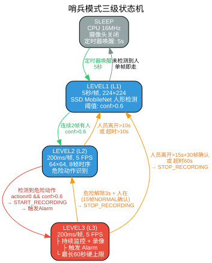
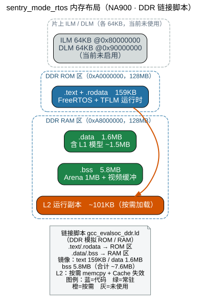
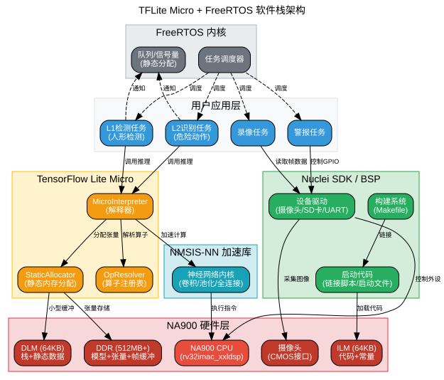

# N900 车载哨兵模式视觉监控系统详细设计文档

**文档版本**: 4.0  
**创建日期**: 2025-03-26  
**更新日期**: 2026-04-25  
**适用平台**: Nuclei N900 系列 RISC-V 处理器  
**实现状态**: ✅ 代码已实现，编译通过（TFLM 真实模型集成）  
**参考实施记录**: 哨兵功能神经网络模型集成记录.md  
**GitHub 仓库**: https://github.com/cryindance/sentry-mode-rtos  

---

## 版本变更记录

### v4.0 (2026-04-25)
- **以实施记录校准**: 根据《哨兵功能神经网络模型集成记录》更新所有技术参数
- **输入分辨率**: L1 模型输入从 192×192 修正为 224×224
- **Tensor Arena**: 从 80KB 修正为 1MB（实测值）
- **OpResolver**: 从 5 个算子示例更新为 15 个完整算子列表
- **接口扩展**: 新增 `DetectionBox` 结构体、`ai_get_detection_boxes()` 接口、`extern "C"` 包装
- **Makefile**: 更新为 TFLM 中间件集成方式（`MIDDLEWARE := tflm`）+ `CXX_SRCDIRS`
- **编译命令**: 补全 `DOWNLOAD=ddr` 参数、新增实测编译数据
- **文件结构**: `ai_engine.c` → `ai_engine.cpp`，新增模型文件
- **条件编译**: 标注真实 TFLM 集成状态

### v3.0 (2026-04-22)
- **文档合并**: 将技术方案文档与详细设计文档合并为完整文档
- **AI模型选型**: 新增目标检测与图像分类对比分析
- **TFLM集成**: 添加 TensorFlow Lite Micro 完整集成方案
- **SDK说明**: 补充 Nuclei SDK 角色与功能说明
- **构建系统**: 新增增量编译和固件构建说明

### v2.0 (2025-03-26)
- **架构升级**: 从两级(L1/L2)升级为三级(L1/L2/L3)状态机
- **新增功能**: Level 3 持续监控+录像状态
- **实现细节**: 添加 FreeRTOS 静态分配、条件编译配置
- **编译验证**: 成功编译生成 ELF 文件

### v1.0 (2025-03-26)
- 初始技术方案，两级架构设计

---

## 1. 项目概述

### 1.1 应用场景
车载停车监控（哨兵模式），实现以下功能：
- **Level 1**: 低功耗监控（5秒/帧），检测是否有人靠近车辆
- **Level 2**: 高帧率识别（5 FPS），识别人员的危险动作（砸车、撬门、划车、攀爬）
- **事件响应**: 检测到危险后触发警报并录制视频证据

### 1.2 硬件平台规格
| 组件 | 规格 | 说明 |
|------|------|------|
| CPU | N900FD | 32位 RISC-V，带FPU和DSP扩展 |
| 指令内存(ILM) | 64KB | 存放代码，静态分配 |
| 数据内存(DLM) | 64KB | 任务栈和缓冲区，静态分配 |
| 外部DDR | 512MB+ | Level 2/3模型、视频缓冲 |
| 摄像头 | 200万像素 | DVP/MIPI接口，支持低功耗 |
| 存储 | SD卡 / eMMC | 存储视频证据（可选） |

### 1.3 软件实现状态

| 功能模块 | 状态 | 说明 |
|----------|------|------|
| 三级状态机 | ✅ 完成 | L1/L2/L3 状态切换逻辑 |
| FreeRTOS任务 | ✅ 完成 | 5个任务，静态内存分配 |
| AI推理框架 | ✅ 完成 | TFLM 真实集成，SSD MobileNet v2 模型 |
| L2 动作识别 | ✅ Demo | CNN+LSTM(101KB)，UCF101训练，编译通过 |
| 文件系统 | ⚠️ 占位 | 条件编译(NO_STORAGE)，等待FatFs |
| 编译系统 | ✅ 完成 | Makefile配置，MIDDLEWARE 集成，成功编译 |
| 文档 | ✅ 完成 | 详细设计文档、README、LSP配置 |

---

## 2. 系统架构设计

### 2.1 三级状态机



**状态定义**：

| 状态 | 说明 |
|------|------|
| SLEEP | CPU 16MHz，摄像头关闭，等待定时器唤醒（5秒） |
| LEVEL1 (L1) | 低功耗监控，5秒/帧，224×224 SSD MobileNet 人形检测 |
| LEVEL2 (L2) | 高帧率跟踪，200ms/帧(5FPS)，64×64 8帧时序危险动作识别 |
| LEVEL3 (L3) | 持续监控+录像，200ms/帧(5FPS)，最长60秒硬上限 |

**状态转换详解**：

| 转换 | 触发条件 | 确认机制 | 动作 |
|------|---------|---------|------|
| SLEEP → L1 | 定时器唤醒（5秒） | 硬件唤醒 | camera_init，CPU 160MHz |
| L1 → SLEEP | 未检测到人 | 单帧即走 | camera_power_down，CPU 16MHz，WFI |
| L1 → L2 | 连续2帧有人（conf>0.6） | 连续帧防误报 | ai_switch_mode(MODE_LEVEL2) |
| L2 → L3 | 危险动作（action≠0, conf>0.6） | 单帧即触发 | **START_RECORDING**，触发Alarm（蜂鸣器+车灯） |
| L2 → L1 | 人员离开>10s | s_person_present=false | ai_switch_mode(MODE_LEVEL1) |
| L2 → L1 | 超时>10s | LEVEL2_MAX_DURATION_MS | ai_switch_mode(MODE_LEVEL1) |
| L3 → L2 | 危险解除+人还在 | 连续15帧NORMAL（3秒） | **STOP_RECORDING**，继续监控 |
| L3 → L1 | 人员离开>15s | 30帧确认（6秒） | **STOP_RECORDING**，ai_switch_mode(MODE_LEVEL1) |
| L3 → L1 | 硬超时>60s | LEVEL3_MAX_DURATION_MS | **STOP_RECORDING**，ai_switch_mode(MODE_LEVEL1) |

**关键时间参数**：

| 参数 | 值 | 含义 |
|------|-----|------|
| LEVEL1_INTERVAL_MS | 5000ms | L1 检测间隔 |
| LEVEL2_FRAME_PERIOD_MS | 200ms | L2/L3 推理节拍 |
| LEVEL2_HISTORY_FRAMES | 8 | 时序输入帧数 |
| LEVEL2_MAX_DURATION_MS | 10000ms | L2 无危险超时 |
| LEVEL3_MAX_DURATION_MS | 60000ms | L3 安全硬上限 |
| LEVEL3_PERSON_LOST_TIMEOUT_MS | 15000ms | L3 人员离开判定 |
| 危险解除确认 | 15帧(3s) | s_normal_count |
| 人员离开确认 | 30帧(6s) | s_no_person_count |

**录像与警报职责**：

| 组件 | 职责 | 边界 |
|------|------|------|
| AI 任务 | 管理全部状态转换 | 唯一的状态写入者 |
| Recorder | 响应 START/STOP 命令 | 不参与状态决策 |
| Alarm 任务 | 触发/停止蜂鸣器+车灯（30秒） | **不修改系统状态和AI模式** |

### 2.2 软件架构实现

**架构选择**: FreeRTOS + 静态内存分配

| 任务 | 优先级 | 周期 | 栈大小 | 职责 |
|------|--------|------|--------|------|
| **AI主任务** | 3 | 可变 | 16KB | 状态机管理、推理、状态切换 |
| **视频录制** | 2 | 33ms | 16KB | 高清采集、推送到写入队列 |
| **文件写入** | 1 | 阻塞等待 | 16KB | SD卡写入（后台） |
| **系统监控** | 1 | 10秒 | 8KB | 统计信息打印 |
| **警报处理** | 4 | 通知触发 | 8KB | 声光警报、30秒后停止 |

**选择RTOS静态分配的关键原因**：
- **避免堆碎片**: 嵌入式系统长时间运行，堆碎片会导致分配失败
- **确定性**: 编译时即可确定内存使用，便于资源规划
- **可靠性**: 无需运行时动态分配，减少失败风险
- **SD卡写入延迟**: 10-500ms不可预测，通过队列解耦不影响AI任务

**FreeRTOS 内存分配配置**:
```c
// FreeRTOSConfig.h 关键配置
#define configSUPPORT_STATIC_ALLOCATION     1
#define configSUPPORT_DYNAMIC_ALLOCATION    1  // 保留动态分配能力，当前所有任务使用静态分配
#define configTOTAL_HEAP_SIZE               (32 * 1024)

// 静态缓冲区定义
static StaticTask_t s_task_ai_buffer;
static StackType_t s_task_ai_stack[4096] __attribute__((section(".dlm")));

// 钩子函数实现
void vApplicationGetIdleTaskMemory(...);
void vApplicationGetTimerTaskMemory(...);
void vApplicationStackOverflowHook(...);
```

---

## 3. 模块详细设计

### 3.1 FreeRTOS 静态分配设计

本项目以 **FreeRTOS 静态内存分配** 为主要机制，避免运行时堆碎片问题。所有任务、队列、信号量均在编译时分配内存。FreeRTOS 配置同时保留动态分配能力（`configSUPPORT_DYNAMIC_ALLOCATION = 1`），作为安全余量。

#### 3.1.1 静态分配钩子函数

在 `main.c` 中实现了以下 FreeRTOS 必需的钩子函数：

```c
// 空闲任务内存 (512字节栈)
static StaticTask_t s_idle_task_buffer;
static StackType_t s_idle_task_stack[512];

// 定时器任务内存 (512字节栈)
static StaticTask_t s_timer_task_buffer;
static StackType_t s_timer_task_stack[512];

// 钩子函数实现
void vApplicationIdleHook(void);              // 系统空闲钩子
void vApplicationGetIdleTaskMemory(...);      // 获取空闲任务内存
void vApplicationGetTimerTaskMemory(...);     // 获取定时器任务内存
void vApplicationStackOverflowHook(...);      // 栈溢出处理
```

**空闲任务钩子** (`vApplicationIdleHook`):  
- 可在系统空闲时执行额外处理
- 适合实现 WFI (Wait For Interrupt) 低功耗模式

**栈溢出钩子** (`vApplicationStackOverflowHook`):  
- 检测到任务栈溢出时触发
- 记录错误任务名，进入死循环便于调试

#### 3.1.2 任务创建与内存分配

所有任务使用 `xTaskCreateStatic()` 创建，任务栈使用 `__attribute__((section(".dlm")))` 指定存放在 DLM 区域：

```c
// 任务TCB缓冲区 (放在DLM)
static StaticTask_t s_task_ai_buffer;
static StaticTask_t s_task_recorder_buffer;
static StaticTask_t s_task_writer_buffer;
static StaticTask_t s_task_monitor_buffer;
static StaticTask_t s_task_alarm_buffer;

// 任务栈 (放在DLM)
static StackType_t s_task_ai_stack[4096] __attribute__((section(".dlm")));      // 16KB (4096 words)
static StackType_t s_task_recorder_stack[4096] __attribute__((section(".dlm"))); // 16KB (4096 words)
static StackType_t s_task_writer_stack[4096] __attribute__((section(".dlm")));   // 16KB (4096 words)
static StackType_t s_task_monitor_stack[2048] __attribute__((section(".dlm")));  // 8KB (2048 words)
static StackType_t s_task_alarm_stack[2048] __attribute__((section(".dlm")));    // 8KB (2048 words)

// 队列缓冲区
static uint8_t s_cmd_queue_storage[4 * sizeof(SystemCommand)];
static uint8_t s_frame_queue_storage[VIDEO_QUEUE_LENGTH * VIDEO_FRAME_SIZE];
static StaticQueue_t s_cmd_queue_buffer;
static StaticQueue_t s_frame_queue_buffer;

// 事件组和互斥锁
static StaticEventGroup_t s_event_group_buffer;
static StaticSemaphore_t s_state_mutex_buffer;
```

#### 3.1.3 AI主任务 (task_ai_master)

**优先级**: 3 (最高)  
**周期**: 可变（Level 1: 5秒, Level 2/L3: 200ms）  
**栈大小**: 16384字节 (4096 words)

**职责**:
- 状态机管理（Level 1/2/3切换）
- 图像采集
- 神经网络推理
- 检测结果判断
- 触发录制任务和警报任务

**状态切换逻辑**:
```c
if (state == STATE_LEVEL1_MONITORING && person_detected) {
    // 连续2帧确认后切换
    set_cpu_frequency(160000000);
    ai_switch_mode(MODE_LEVEL2);
    set_state(STATE_LEVEL2_TRACKING);
} else if (state == STATE_LEVEL2_TRACKING && danger_detected) {
    // 检测到危险，进入Level 3
    set_state(STATE_LEVEL3_CONTINUOUS);
    xTaskNotifyGive(task_alarm);
} else if (state == STATE_LEVEL2_TRACKING && timeout) {
    // 10秒无危险且人离开
    set_state(STATE_LEVEL1_MONITORING);
} else if (state == STATE_LEVEL3_CONTINUOUS) {
    // L3退出条件：危险解除3秒+人还在 → L2
    // 或人离开15秒 / L3超时60秒 → L1
    check_level3_exit_conditions();
}
```

#### 3.1.4 视频录制任务 (task_video_recorder)

**优先级**: 2  
**周期**: 33ms (30 FPS)  
**栈大小**: 16384字节 (4096 words)

**职责**:
- 接收AI任务的录制命令
- 高清视频采集 (320x240 YUV)
- H.264编码或原始帧保存
- 将编码后数据推送到文件写入队列

**缓冲区管理**:
- 使用FreeRTOS队列（长度30 = 1秒缓冲）
- 队列满时丢弃旧帧，保证AI任务不受影响

#### 3.1.5 文件写入任务 (task_file_writer)

**优先级**: 1 (最低)  
**触发方式**: 阻塞等待队列  
**栈大小**: 16384字节 (4096 words)

**职责**:
- 从队列接收视频帧
- FatFs文件系统操作
- SD卡写入（可能耗时10-500ms）
- 文件管理（创建、写入、关闭）

**关键特性**:
- 低优先级确保不阻塞AI任务
- 异步写入，通过队列解耦

#### 3.1.6 警报处理任务 (task_alarm_handler)

**优先级**: 4 (最高，短时任务)  
**触发方式**: 任务通知  
**栈大小**: 8192字节（2048 words）

**职责**:
- 接收AI任务的危险检测通知
- 触发声光警报（蜂鸣器、车灯闪烁）
- 4G/WiFi远程通知发送
- 警报持续30秒后自动停止

### 3.2 条件编译配置

为支持在不依赖 FatFs 和 TensorFlow Lite Micro 库的情况下编译，项目使用条件编译宏控制功能模块：

#### 3.2.1 条件编译宏定义

**在 `Makefile` 中定义：**

```makefile
# 编译优化和日志级别
COMMON_FLAGS += -DUSE_NMSIS_NN
COMMON_FLAGS += -DSENTRY_LOG_LEVEL=1

# 当前SDK未提供 FatFs 库，暂时禁用
# COMMON_FLAGS += -DUSE_FATFS

# 模拟/占位模式（存储模块，无实际功能，仅用于编译测试）
COMMON_FLAGS += -DNO_STORAGE

# NO_AI_ENGINE 已在真实 TFLM 集成后移除，不再使用
# COMMON_FLAGS += -DNO_AI_ENGINE    ← 已移除，当前使用真实 TFLM
```

**条件编译使用方式：**

```c
// FatFs 文件系统 (storage.c, tasks.c)
#ifndef NO_STORAGE
#include "ff.h"
#else
// 提供占位类型定义
typedef unsigned int UINT;
typedef struct { char dummy[64]; } FIL;
#define FA_WRITE        0x02
#define FA_CREATE_ALWAYS 0x08
#define FR_OK           0
#define FRESULT         int
#endif

// TensorFlow Lite (ai_engine.cpp, tasks.c) — NO_AI_ENGINE 已不再定义，以下为历史占位代码参考
#ifndef NO_AI_ENGINE
typedef struct tflite_MicroInterpreter { void* impl; } tflite_MicroInterpreter;
extern tflite_MicroInterpreter *g_interpreter;
#else
typedef struct tflite_MicroInterpreter { void* impl; } tflite_MicroInterpreter;
#define g_interpreter NULL
#endif
```

**代码中使用：**

```c
// tasks.c - 视频录制任务
#ifndef NO_STORAGE
if (f_open(&s_fil, filename, FA_WRITE | FA_CREATE_ALWAYS) == FR_OK) {
    // 实际文件操作
}
f_close(&s_fil);
#else
// NO_STORAGE 模式：仅记录日志，跳过文件操作
(void)filename;
#endif

// tasks.c - 文件写入任务
#ifndef NO_STORAGE
FRESULT res = f_write(&s_fil, frame, VIDEO_FRAME_SIZE, &written);
if (res != FR_OK || written != VIDEO_FRAME_SIZE) {
    LOG_ERROR("SD write failed!");
}
#else
(void)frame;  // 消除未使用变量警告
#endif
```

### 3.3 内存管理设计

#### 3.3.1 内存布局



#### 3.3.2 模型加载策略

**Level 1模型 (SSD MobileNet v2)**:
- 位置: Flash → Flash (常驻，无需加载)
- 大小: ~1.5MB
- 加载时机: 系统启动时（或常驻Flash）
- 常驻: 是（快速唤醒需要）
- 推理时间: ~50-100ms

**Level 2模型 (CNN+GRU)**:
- 位置: Flash → DDR (动态加载)
- 大小: ~300KB
- 加载时机: Level 1检测到人员时
- 常驻: 否（节省DDR空间）
- 推理时间: ~150-250ms

**加载代码逻辑**:
```c
void load_model_to_ddr(void) {
    // 从Flash复制到DDR
    memcpy((void*)DDR_MODEL_L2_ADDR, 
           (void*)FLASH_MODEL_L2_ADDR, 
           MODEL_L2_SIZE);
    
    // Cache同步（关键！）
    __DSB();
    __ISB();
    
    // 使对应Cache行失效（如果启用D-Cache）
    #ifdef __DCACHE_PRESENT
    DCACHE_InvalidateByAddr((void*)DDR_MODEL_L2_ADDR, MODEL_L2_SIZE);
    #endif
}
```

### 3.4 神经网络设计

#### 3.4.1 AI 模式常量定义

在 `sentry_mode.h` 中定义 AI 工作模式常量：

```c
// AI模式常量
#define MODE_LEVEL1                 1   // Level 1: 人形检测
#define MODE_LEVEL2                 2   // Level 2: 危险动作识别
```

**使用示例**：
```c
// 初始化时指定模式
if (!ai_init(MODE_LEVEL1)) {
    LOG_ERROR("AI init failed!");
    return false;
}

// 状态切换时切换模式
if (person_detected) {
    if (ai_switch_mode(MODE_LEVEL2)) {
        g_system_state = STATE_LEVEL2_TRACKING;
    }
}
```

#### 3.4.2 Level 1: 人形检测模型

**架构**: SSD MobileNet v2 FPN-lite 0.35（目标检测）  
**输入**: 224×224×3 (RGB)  
**输出**: 目标类别 + 边界框坐标 (x, y, w, h)  
**参数量**: ~1.5MB (int8量化)  
**推理频率**: 0.2 FPS (每5秒一帧)  

**网络结构**:
```
Input (224×224×3)
    ↓ MobileNetV2 骨干网络
   (特征提取)
    ↓ FPN-lite 特征金字塔
   (多尺度特征)
    ↓ SSD 检测头
   (候选框生成)
    ↓ NMS + 阈值过滤
   (最终检测结果)
```

**后处理**:
- 置信度阈值: 0.6
- NMS IoU阈值: 0.4
- 仅保留 `person` 类别（索引 0）
- 连续2帧确认（防止误报）
- 根据边界框大小判断距离（过滤远处路人）

#### 3.4.3 Level 2/L3: 危险动作识别模型

**架构**: CNN + LSTM 时序网络  
**输入**: 8帧 × 64×64×3 (时序数据)  
**输出**: 5维 (Softmax) — ACTION_NORMAL / SMASH / BREAK_IN / SCRATCH / CLIMB  
**参数量**: ~101KB（动态量化）  
**实现状态**: ✅ 已集成，编译通过

**训练数据集**:

| 维度 | 说明 |
|------|------|
| 数据集 | UCF101 子集（从 OpenDataLab 下载） |
| 类别 | 5 类：JugglingBalls(正常)、BoxingPunchingBag(砸窗)、Hammering(砸)、Nunchucks(划车)、HandstandPushups(攀爬) |
| 样本数 | 500 个（每类 100 个，8 帧均匀抽取） |
| 帧尺寸 | 64×64 RGB，dtype=float32，归一化 [0, 1] |

> **备注**: Demo 阶段使用 UCF101 公开数据集替代真实车载视频。真实部署时替换数据集即可复用完整训练流水线。

**训练流水线**（脚本位于 `~/work/l2_training/`）:

| 步骤 | 脚本 | 输入 | 输出 |
|------|------|------|------|
| 预处理 | `preprocess.py` | 原始 `.avi` 视频 | `X.npy` (500,8,64,64,3), `y.npy` (500,) |
| 训练 | `train.py` | 预处理后的 `.npy` | `l2_model.keras` |
| 量化 | `quantize.py` | Keras 模型 | `l2_model_quant.tflite` (101KB) + `.cc` C 数组 |

**训练参数**:

| 参数 | 值 |
|------|-----|
| 优化器 | Adam (lr=0.001) |
| 损失函数 | categorical_crossentropy |
| Batch Size | 1（CPU 训练，内存受限） |
| Epochs | 15 |
| 训练/验证 | 80%/20%（stratify split） |

**模型大小对比**:

| 版本 | 大小 | 说明 |
|------|------|------|
| Keras 原始 (float32) | ~800KB | 训练产物 |
| TFLite 动态量化 | **101KB** | 权重 INT8，激活 float32，实际集成 |
| INT8 全量化 | 未成功 | 与 LSTM TensorList ops 有兼容性问题 |

> **量化说明**: INT8 全量化在 LSTM 模型上需要校准数据集，在 8GB 虚拟机上触发段错误。改用动态范围量化（仅权重量化为 INT8），模型仍可用 NMSIS-NN DSP 加速卷积部分。

**TFLM 集成**:

| 文件 | 作用 |
|------|------|
| `inc/l2_model.h` | extern 声明：模型数据 + 长度 |
| `src/l2_model_quant.cc` | C 数组（624KB 源文件，101KB 模型） |
| `src/ai_engine.cpp` | MODE_LEVEL2 分支：加载模型 → AllocateTensors → Invoke → 取 top-1 |
| Tensor Arena | 256KB 静态分配 |

**TensorFlow-Lite → TFLM 兼容性**: 模型使用 `unroll=True` 选项训练 LSTM，避免标准 LSTM 生成的 `FlexTensorList` ops（TFLM 不支持）。所有 6 个算子均在 Nuclei TFLM NPK 算子表中。

### 3.5 文件系统设计

#### 3.5.1 FatFs 条件编译实现

项目支持两种模式运行：

**1. 完整模式 (USE_FATFS)**
- 需要 SDK 提供 FatFs 库
- 完整文件系统功能
- SD 卡视频录制

**2. 占位模式 (NO_STORAGE)**
- 无需外部库
- 仅用于编译测试
- 文件操作被替换为空操作

**storage.c 条件编译示例：**

```c
// 删除最旧文件（仅完整模式）
#ifndef NO_STORAGE
static void delete_oldest_file(void)
{
    DIR dir;
    FILINFO fno;
    FILINFO oldest;
    // ... 实际的 FatFs 操作
}
#endif

// SD卡初始化
bool sd_card_init(void)
{
    if (s_sd_initialized) {
        return true;
    }
    
#ifdef NO_STORAGE
    LOG_INFO("SD card disabled (NO_STORAGE mode)");
    s_sd_initialized = true;
    return true;
#else
    FRESULT res = f_mount(&s_fatfs, "", 1);
    if (res != FR_OK) {
        LOG_ERROR("SD mount failed: %d", res);
        return false;
    }
    // ... 完整初始化流程
#endif
}
```

#### 3.5.2 FatFs配置（完整模式）

**文件系统**: FAT32 (exFAT如果支持>4GB文件)  
**块大小**: 4096字节 (与SD卡扇区对齐)  
**缓冲策略**: 双缓冲写入，512B或4096B缓冲

#### 3.5.3 文件命名规则

```
格式: /sdcard/sentry/YYYYMMDD_HHMMSS_XXX.avi
示例: /sdcard/sentry/20250326_143052_001.avi

说明:
- YYYYMMDD: 日期
- HHMMSS: 时间
- XXX: 序号(001-999)
- .avi: 视频格式(原始YUV或MJPEG)
```

#### 3.5.4 存储管理

- 循环覆盖: 当SD卡满时，删除最旧的文件
- 保留空间: 始终保留100MB空闲空间
- 文件大小估算:  
  - 30秒 × 30 FPS × 320×240×2 = ~138MB (原始YUV)  
  - 30秒 × 30 FPS × 50KB (MJPEG压缩) = ~45MB

### 3.6 低功耗设计

#### 3.6.1 功耗状态

| 状态 | CPU频率 | 外设 | 功耗估算 | 持续时间 |
|------|---------|------|----------|----------|
| Sleep | 停时钟 | 仅定时器 | ~2mW | 4.9秒/周期 |
| Level1 | 16~160MHz | 摄像头(短暂) | ~8mW（加权） | 100ms/5秒 |
| Level2 | 160MHz | 摄像头+SD卡 | ~100mW | 10秒(触发时) |
| Alarm | 160MHz | 全外设 | ~150mW | 30秒 |

#### 3.6.2 低功耗实现

```c
void enter_deep_sleep(uint32_t sleep_ms) {
    // 1. 保存状态
    save_system_state();
    
    // 2. 关闭外设
    camera_power_down();
    sd_card_sleep();
    disable_unused_clocks();
    
    // 3. 配置唤醒源
    setup_timer_wakeup(sleep_ms);
    
    // 4. 进入WFI
    __WFI();
    
    // 5. 唤醒后恢复
    restore_system_state();
}
```

### 3.7 AI模型选型与TensorFlow Lite Micro集成

#### 3.7.1 目标检测与图像分类的区别

在嵌入式视觉AI中，**目标检测**（Object Detection）和**图像分类**（Image Classification）是两类基础任务，其核心差异如下：

| 对比维度 | 目标检测 | 图像分类 |
|---------|---------|---------|
| **输出内容** | 目标类别 + 边界框坐标 (x, y, w, h) | 仅目标类别（整张图的标签） |
| **位置信息** | ✅ 有（可判断目标在画面中的位置） | ❌ 无（仅知道"图中有XX"） |
| **计算量** | 较大（需预测多个候选框） | 较小（只需全局特征） |
| **典型模型** | YOLO、SSD MobileNet | MobileNet、ResNet |
| **适用场景** | 需要定位、跟踪、测距 | 仅需识别场景类型 |

**为什么 L1 必须使用目标检测？**

L1 阶段不仅需要知道"画面中有人"，还必须获取**人的位置**和**边界框大小**，才能：
1. 判断人员是否在**接近**车辆（框的中心点移动趋势）
2. 计算人员与车辆的**距离**（框的大小变化）
3. 排除远处路人误报（框太小则过滤）

图像分类只能回答"这张图里有没有人"，无法提供位置信息，因此**不满足 L1 需求**。

#### 3.7.2 各层级模型选型

| 层级 | 任务类型 | 模型类型 | 输入分辨率 | 模型大小 | 推理频率 |
|------|---------|---------|-----------|---------|---------|
| **L1** | 人形检测 | 目标检测 | 224×224 | ~1.5MB | 0.2 FPS |
| **L2** | 危险动作识别 | 时序分类 | 8×64×64 | ~300KB | 5 FPS |
| **L3** | 持续监控+录像 | 同L2 | 同L2 | 同L2 | 5 FPS |

#### 3.7.3 Nuclei预训练模型推荐

Nuclei官方提供了经过优化的预训练模型仓库（`nuclei-ai-models`），针对 RISC-V 嵌入式平台进行了 INT8 量化和算子优化。

**L1 人形检测推荐模型：**

| 模型 | 骨干网络 | 分辨率 | 量化 | 大小 | 特点 |
|------|---------|--------|------|------|------|
| **SSD MobileNet v2 FPN-lite 0.35** | MobileNet v2 | 224×224 | INT8 | ~1.5MB | ⭐ 推荐，最轻量，功耗最低 |
| YOLOv8n | YOLOv8 | 192×192 | INT8 | ~3.2MB | 精度更高，但计算量大 |
| SSD MobileNet v2 FPN-lite 0.35 | MobileNet v2 | 416×416 | INT8 | ~2.8MB | 高分辨率，精度提升有限 |

> **推荐选择**：`SSD MobileNet v2 FPN-lite 0.35 × 224×224`
> - 仅检测 `person` 类别（COCO_Person 子集），模型更小
> - INT8 量化后模型仅约 1.5MB，可常驻 Flash
> - 推理一次约 50-100ms，满足 L1 低功耗需求
> - 输出边界框坐标，支持人员距离判断和接近检测
> - **实际集成验证**：已在 N900FD + DDR 平台完成真实 TFLM 推理集成，编译产出 ELF 约 7.6MB

**L2 危险动作识别模型：**

L2 需要自定义训练，因为危险动作（砸车、撬门、划车、攀爬）属于**特定领域**，没有公开预训练模型。建议：
1. 基于 MobileNetV2 提取单帧特征
2. 叠加 GRU/LSTM 进行时序建模（8帧输入）
3. 使用 TensorFlow Lite 全整数量化导出 `.tflite` 模型

#### 3.7.4 TensorFlow Lite Micro 集成架构

TensorFlow Lite Micro（TFLM）是 Google 专为微控制器设计的轻量级推理框架，无操作系统依赖，可在 FreeRTOS 上直接运行。



**软件栈分层说明：**

| 层级 | 组件 | 职责 |
|------|------|------|
| 应用层 | L1/L2/录像/警报任务 | 业务逻辑、调用推理API |
| FreeRTOS | 任务调度器、队列、信号量 | 多任务管理、任务间通信 |
| TFLM | MicroInterpreter、StaticAllocator、OpResolver | 模型解析、张量分配、算子执行 |
| NMSIS-NN | 卷积/池化/全连接加速 | 利用 N900 DSP 指令加速 |
| SDK/BSP | Makefile、驱动、启动代码 | 构建系统、硬件抽象 |
| 硬件 | N900FD CPU、ILM/DLM/DDR | 代码执行、数据存储 |

#### 3.7.5 模型格式与转换流程

TFLM 不支持直接读取 `.tflite` 文件，需要将模型转换为 **C 语言数组** 编译进固件：

```bash
# 1. 使用 xxd 将 .tflite 转为 C 数组
xxd -i model_person_detect.tflite > model_person_detect.cc

# 2. 生成的 C 文件格式
unsigned char g_model_person_detect[] = {
    0x1c, 0x00, 0x00, 0x00,  // TFLite 文件头
    ...
};
unsigned int g_model_person_detect_len = 153600;
```

**模型加载代码：**

```c
// ai_engine.c
#include "model_person_detect.cc"  // 编译时嵌入模型

static tflite::MicroInterpreter* s_interpreter = nullptr;
static tflite::MicroAllocator* s_allocator = nullptr;

bool ai_init_level1(void) {
    // 1. 加载模型
    const tflite::Model* model = 
        tflite::GetModel(g_model_person_detect);
    
    // 2. 注册所需算子（SSD MobileNet v2 FPN-lite 完整算子列表）
    static tflite::MicroMutableOpResolver<15> resolver;
    resolver.AddQuantize();
    resolver.AddDequantize();
    resolver.AddConv2D();
    resolver.AddDepthwiseConv2D();
    resolver.AddPad();
    resolver.AddAdd();
    resolver.AddShape();
    resolver.AddStridedSlice();
    resolver.AddPack();
    resolver.AddReshape();
    resolver.AddResizeBilinear();
    resolver.AddConcatenation();
    resolver.AddSoftmax();
    
    // 3. 分配张量内存（静态，放在 DDR）
    static uint8_t tensor_arena[1024 * 1024]  // 1MB 张量缓冲（实测值）
        __attribute__((section(".ddr_bss")));
    
    // 4. 创建解释器
    s_interpreter = new (reinterpret_cast<void*>(tensor_arena + 4096))
        tflite::MicroInterpreter(model, resolver, 
                                  tensor_arena, sizeof(tensor_arena));
    
    // 5. 分配张量
    TfLiteStatus allocate_status = s_interpreter->AllocateTensors();
    return (allocate_status == kTfLiteOk);
}
```

#### 3.7.6 TFLM 推理任务设计

```c
// ai_task.c - FreeRTOS 任务
static void task_ai_inference(void* pvParameters) {
    while (1) {
        // 等待图像采集完成
        uint8_t* frame = xQueueReceive(g_frame_queue, ...);
        
        // 预处理：裁剪、缩放、量化
        preprocess_frame(frame, s_interpreter->input(0)->data.int8);
        
        // 执行推理
        TfLiteStatus status = s_interpreter->Invoke();
        if (status != kTfLiteOk) {
            LOG_ERROR("Inference failed!");
            continue;
        }
        
        // 后处理：NMS + 阈值过滤（仅目标检测需要）
        DetectionResult results[10];
        int num = post_process(s_interpreter->output(0), 
                               s_interpreter->output(1),
                               results, 10);
        
        // 发送检测结果
        xQueueSend(g_result_queue, &results[0], portMAX_DELAY);
    }
}
```

**后处理要点（目标检测）：**
- **NMS（非极大值抑制）**：去除重叠框，保留最佳检测框
- **置信度阈值**：如 0.6，低于此值的检测结果丢弃
- **类别过滤**：仅保留 `person` 类别（索引 0）

#### 3.7.7 内存优化策略

| 优化措施 | 实现方式 | 效果 |
|---------|---------|------|
| 静态张量分配 | `static uint8_t tensor_arena[1MB]` | 无堆碎片，确定性内存 |
| 模型放 Flash | `const` 修饰，链接到 `.rodata` | 不占用 RAM |
| 输入缓冲复用 | 摄像头 DMA 直接写入张量输入 | 减少一次拷贝 |
| INT8 量化 | 全整数量化模型 | 模型大小减少 75%，速度提升 2-4x |
| NMSIS-NN | 启用 `USE_NMSIS_NN` 宏 | 利用 SIMD/DSP 指令加速 |

> **注**: Tensor Arena 早期方案预估为 100KB，实测集成的 SSD MobileNet v2 FPN-lite 0.35 (224×224) 需要约 **1MB** 张量缓冲。见《哨兵功能神经网络模型集成记录》实测数据。

---

## 4. 接口定义

### 4.1 模块接口

#### 4.1.1 内存管理模块

```c
// memory_manager.h
bool ddr_sanity_check(void);
bool ddr_init(void);
bool load_model_to_ddr(uint32_t model_id);
void* get_tensor_arena(void);
void* get_frame_buffer(void);
```

#### 4.1.2 硬件抽象层

```c
// hal.h
bool hal_init(void);
bool camera_init(void);
void camera_power_down(void);
bool camera_capture_rgb(uint8_t* buffer, int width, int height);
bool camera_capture_yuv320(uint8_t* buffer);
void trigger_alarm(void);
void stop_alarm(void);
uint32_t get_system_time_ms(void);
```

#### 4.1.3 AI推理模块

```c
// sentry_mode.h - AI 模式常量定义
#define MODE_LEVEL1    1   // Level 1: 人形检测
#define MODE_LEVEL2    2   // Level 2: 危险动作识别

// 检测框结构体（目标检测输出）
typedef struct {
    int x_min;
    int y_min;
    int x_max;
    int y_max;
    float score;
} DetectionBox;

// 支持 C/C++ 混合编译
#ifdef __cplusplus
extern "C" {
#endif

// ai_engine.cpp - AI 引擎接口（"C" 链接）
bool ai_init(int mode);
bool ai_switch_mode(int new_mode);
bool ai_run_inference(uint8_t* input_frame);
int ai_get_detection_result(void);
float ai_get_confidence(void);
int ai_get_detection_boxes(DetectionBox* boxes, int max_boxes);

#ifdef __cplusplus
}
#endif
```

**接口说明**：
- `ai_init(mode)`: 初始化 AI 引擎，mode 参数使用 MODE_LEVEL1 或 MODE_LEVEL2
- `ai_switch_mode(mode)`: 运行时切换 AI 模式（Level 1 ↔ Level 2）
- `ai_run_inference()`: 执行一次推理，输入为量化后的图像数据
- `ai_get_detection_result()`: 获取推理结果类别（ACTION_NORMAL=0, ACTION_SMASH=1, ...）
- `ai_get_confidence()`: 获取置信度（0.0 ~ 1.0）
- `ai_get_detection_boxes()`: 获取目标检测边界框（L1 人形检测专用，通过 NMS 后处理后返回多个检测框）

**extern "C" 说明**：AI 引擎源文件为 `ai_engine.cpp`（C++），但必须通过 `extern "C"` 提供 C 链接接口，以便 `tasks.c` 等 C 源文件正确链接。头文件和源文件中均需添加 `extern "C"` 包装。

#### 4.1.4 文件存储模块

```c
// storage.h
bool storage_init(void);
bool storage_create_file(const char* filename);
bool storage_write_frame(uint8_t* data, size_t len);
bool storage_close_file(void);
bool storage_check_space(void);
```

### 4.2 任务间通信

#### 4.2.1 队列定义

```c
// 命令队列: AI任务 -> 录制任务
QueueHandle_t g_cmd_queue;
// 消息类型: START_RECORDING, STOP_RECORDING, LEVEL2_TIMEOUT

// 帧队列: 录制任务 -> 写入任务  
QueueHandle_t g_frame_queue;
// 消息类型: 视频帧数据 (320×240 YUV)
```

#### 4.2.2 事件组

```c
// 系统事件标志
event_flags:
- BIT_0: DANGER_DETECTED (检测到危险)
- BIT_1: PERSON_DETECTED (检测到人)
- BIT_2: SD_CARD_FULL (SD卡满)
- BIT_3: SYSTEM_ERROR (系统错误)
- BIT_4: LEVEL2_TIMEOUT (Level 2超时)
```

#### 4.2.3 任务通知

```c
// AI任务 -> 警报任务 (最高优先级)
xTaskNotifyGive(task_alarm);

// 录制任务 -> 写入任务 (数据就绪)
xTaskNotifyGive(task_writer);
```

---

## 5. 关键算法

### 5.1 状态机算法

```c
SystemState run_state_machine(SystemState current, Event event) {
    switch(current) {
        case STATE_SLEEP:
            if (event == WAKEUP_TIMER) {
                return STATE_LEVEL1;
            }
            break;
            
        case STATE_LEVEL1:
            if (event == PERSON_DETECTED) {
                start_level2_timer();
                return STATE_LEVEL2;
            } else if (event == TIMEOUT) {
                enter_deep_sleep();
                return STATE_SLEEP;
            }
            break;
            
        case STATE_LEVEL2:
            if (event == DANGER_DETECTED) {
                return STATE_LEVEL3;  /* 检测到危险，进入持续监控 */
            } else if (event == TIMEOUT || event == PERSON_LEFT) {
                return STATE_LEVEL1;  /* 无危险且人离开，返回L1 */
            }
            break;
            
        case STATE_LEVEL3:
            /* Level 3 -> Level 2 转换条件：
             * 1. 连续15帧（3秒）检测到 ACTION_NORMAL（危险解除）
             * 2. 人员仍然存在（s_no_person_count < 15）
             * 目的：危险解除但人还在，继续监控但不录像
             */
            if (event == DANGER_CLEARED && event == PERSON_PRESENT) {
                return STATE_LEVEL2;  /* 危险解除但人还在，退回L2 */
            } 
            /* Level 3 -> Level 1 转换条件1：
             * 人员离开超过15秒（LEVEL3_PERSON_LOST_TIMEOUT_MS）
             * 且连续30帧（6秒）未检测到人
             */
            else if (event == PERSON_LEFT) {
                return STATE_LEVEL1;  /* 人离开，返回L1 */
            } 
            /* Level 3 -> Level 1 转换条件2：
             * 达到最大持续时间60秒（LEVEL3_MAX_DURATION_MS）
             * 安全机制，防止长时间运行
             */
            else if (event == L3_MAX_TIMEOUT) {
                return STATE_LEVEL1;  /* L3超时，返回L1 */
            }
            break;
    }
    return current;
}
```

### 5.2 帧缓冲区管理（环形队列）

```c
// 时序帧缓冲（Level 2使用）
typedef struct {
    int8_t frames[LEVEL2_HISTORY][FRAME_SIZE];
    uint8_t write_idx;
    uint8_t count;
} FrameHistory;

void frame_history_push(FrameHistory* hist, int8_t* new_frame) {
    memcpy(hist->frames[hist->write_idx], new_frame, FRAME_SIZE);
    hist->write_idx = (hist->write_idx + 1) % LEVEL2_HISTORY;
    if (hist->count < LEVEL2_HISTORY) hist->count++;
}

void frame_history_get_ordered(FrameHistory* hist, int8_t* output) {
    // 按时间顺序排列（最旧到最新）
    for (int i = 0; i < LEVEL2_HISTORY; i++) {
        int src = (hist->write_idx + i) % LEVEL2_HISTORY;
        memcpy(output + i*FRAME_SIZE, hist->frames[src], FRAME_SIZE);
    }
}
```

---

## 6. 编译系统配置

### 6.1 Makefile 配置

**核心配置参数**：

```makefile
# 目标平台: N900FD (32位 RISC-V，带DSP扩展)
CORE = n900fd
ARCH_EXT = _xxldsp

# 下载模式: DDR (大内存支持，模型放DDR运行)
DOWNLOAD = ddr

# RTOS: FreeRTOS
RTOS = FreeRTOS

# 源码目录
SRCDIRS = . src
CXX_SRCDIRS = src
INCDIRS = . inc

# 编译优化
COMMON_FLAGS += -O2 -g
COMMON_FLAGS += -DUSE_NMSIS_NN
COMMON_FLAGS += -DSENTRY_LOG_LEVEL=1

# TFLM 中间件（SDK 内置）
MIDDLEWARE := tflm
NMSIS_LIB := nmsis_nn

# 真实 AI 集成（已移除 NO_AI_ENGINE 占位宏）
# 存储模块仍为占位模式（SDK 未提供 FatFs）
COMMON_FLAGS += -DNO_STORAGE
```

**架构说明**：
- `rv32imafdc_xxldsp`: 32位RISC-V，整数乘除、原子操作、单双精度浮点、DSP扩展
- `ilp32d`: 32位整数/长整型/指针，双精度浮点ABI
- `nuclei-900-series`: 针对N900系列优化

#### 6.1.1 N900 算力与模型推理时间

**N900FD 处理器算力**：

| 参数 | 值 | 说明 |
|------|-----|------|
| 流水线 | 9 级双发射 | 每周期最多 2 条指令 |
| DSP SIMD 宽度 | 4~8 INT8/指令 | XxLdsp 扩展 |
| 理论峰值 | 12~24 GMACs/s | INT8 乘加运算 |
| 硅片频率 | 1.5GHz | TSMC28HPC+（标称） |
| 有效算力 | ~6 GMACs/s | 利用率 40-50%，含缓存未命中 |
| TOPS（等效） | ~0.04 TOPS | 1 TOPS = 1000 GMACs/s |

**L1 目标检测模型（SSD MobileNet v2 FPN-lite 0.35 × 224×224 INT8）**：

| 参数 | 值 |
|------|-----|
| MAC 运算量 | ~350M |
| 推理时间 @ 1.5GHz | 50-100ms（有效利用率 33-67%） |
| 推理时间 @ 200MHz FPGA | 400-900ms |
| 推理时间 @ 100MHz FPGA | 800ms-1.8s |
| L1 检测周期 | 5s → 全部平台有余量 |

**L2 动作识别模型（CNN + LSTM × 8帧 × 64×64 INT8）**：

| 参数 | 值 |
|------|-----|
| CNN 单帧 MAC | ~1.7M（Conv2D + DepthwiseConv2D × 2） |
| 8 帧 CNN 合计 | ~13.6M MACs |
| LSTM(64) 8 步 | ~0.3M MACs |
| **总 MAC** | **~14M** |
| 推理时间 @ 1.5GHz | 2-3ms |
| 推理时间 @ 200MHz FPGA | 15-20ms |
| 推理时间 @ 100MHz FPGA | 30-40ms |
| L2 帧周期 | 200ms → 5~100 倍安全余量 ✅ |

**vTaskDelayUntil 约束**：

L2/L3 使用 `vTaskDelayUntil` 维持固定节拍，要求**推理耗时必须小于 `LEVEL2_FRAME_PERIOD_MS`（200ms）**，否则节拍失效。

| 平台 | 频率 | L1 耗时 | L2 耗时 | 200ms可用? | 建议周期 |
|------|------|---------|---------|:---:|---------|
| N900 硅片 | 1.5GHz | 50-100ms | 2-3ms | ✅ | 200ms |
| FPGA 高端 | 200MHz | 400-900ms | 15-20ms | ✅ | 200ms |
| FPGA 典型 | 100MHz | 800ms-1.8s | 30-40ms | ✅ | 200ms |

> L2 推理极轻，在所有平台上 200ms 内完成。L1 用 5 秒间隔，不受节拍约束。

### 6.2 条件编译宏详解

| 宏定义 | 说明 | 默认值 |
|--------|------|--------|
| `NO_STORAGE` | 禁用FatFs文件系统，SD卡操作变为空 | 定义 |
| `USE_NMSIS_NN` | 启用NMSIS-NN神经网络库 | 定义 |
| `SENTRY_LOG_LEVEL` | 日志级别 (0=ERROR, 1=INFO, 2=DEBUG) | 1 |

**使用场景**：
- **开发阶段**: 曾使用 `NO_AI_ENGINE` 进行代码框架验证（已废弃）
- **集成阶段**: 已移除 `NO_AI_ENGINE`，使用真实 TFLM 推理（当前状态）
- **生产阶段**: 设置 `SENTRY_LOG_LEVEL=0` 减少日志输出

### 6.3 构建命令

```bash
# 编译（必须同时指定 CORE 和 DOWNLOAD）
make CORE=n900fd ARCH_EXT=_xxldsp DOWNLOAD=ddr all

# 清理
make clean

# 查看内存使用
make meminfo

# 烧录到开发板
make CORE=n900fd ARCH_EXT=_xxldsp DOWNLOAD=ddr upload

# 调试
make CORE=n900fd ARCH_EXT=_xxldsp DOWNLOAD=ddr debug

# 查看帮助
make help
```

**实测编译结果（TFLM 真实模型集成后）**：
```
   text    data     bss     dec     hex filename
 159676 1669872 5799392 7628940  74688c sentry_mode_rtos.elf
```
- **text**: 159KB (代码段，含 FreeRTOS + TFLM 运行时)
- **data**: 1.6MB (已初始化数据，含 SSD MobileNet v2 模型 ~1.5MB)
- **bss**: 5.8MB (未初始化数据，含 1MB Tensor Arena + 视频缓冲等)
- **总大小**: 7.6MB

### 6.4 链接脚本

使用DDR模式的链接脚本：
```
LDSCRIPT = $(NUCLEI_SDK_ROOT)/SoC/evalsoc/Board/nuclei_fpga_eval/Source/GCC/gcc_evalsoc_ddr.ld
```

该链接脚本定义了：
- `.text` 段放在 ILM (64KB)
- `.data`/.bss 段放在 DLM (64KB)
- `.ddr_bss` 段放在 DDR (512MB+)，用于大缓冲区

### 6.5 Nuclei SDK 角色与功能

Nuclei SDK 是哨兵模式项目的**基础构建平台**，提供从编译到烧录的完整工具链支持。它本身不是最终固件的一部分，而是构建固件所依赖的基础设施。

**SDK 提供的核心功能：**

| 功能模块 | 说明 | 本项目使用方式 |
|---------|------|--------------|
| **交叉编译工具链** | RISC-V GCC 编译器、链接器、Binutils | 编译 C/C++ 代码为 N900 指令 |
| **FreeRTOS 内核** | 任务调度、队列、信号量、内存管理 | 静态分配，多任务并行运行 |
| **TFLM NPK 包** | TensorFlow Lite Micro 预编译库 | 链接到固件，提供推理能力 |
| **NMSIS-NN 库** | 神经网络 SIMD 加速（DSP 指令） | 启用 `USE_NMSIS_NN` 宏 |
| **BSP 驱动** | 摄像头、UART、GPIO、Timer 驱动 | 直接调用 HAL 接口 |
| **构建系统** | Makefile 模板、链接脚本、启动文件 | 继承并扩展 Makefile |

**SDK 与项目代码的关系：**

```
Nuclei SDK (基础设施)
    ├── 工具链 (riscv-nuclei-elf-gcc)
    ├── FreeRTOS (内核源码)
    ├── TFLM NPK (预编译库)
    ├── NMSIS-NN (加速库)
    ├── BSP (板级驱动)
    └── Makefile (构建模板)
            │
            ▼ 被本项目继承
    哨兵模式项目 (业务代码)
        ├── src/ (任务实现)
        ├── inc/ (头文件)
        ├── models/ (TFLite 模型 C 数组)
        └── Makefile (扩展配置)
```

### 6.6 TFLM 集成配置

**启用 TFLM 的 Makefile 配置：**

```makefile
# Makefile 配置

# 1. TFLM 中间件集成（SDK 内置 build.mk 自动加载）
MIDDLEWARE := tflm

# 2. C++ 编译支持（AI 引擎为 .cpp 文件）
CXX_SRCDIRS = src

# 3. NMSIS-NN 加速库
NMSIS_LIB := nmsis_nn

# 4. 源码和头文件目录
SRCDIRS = . src
INCDIRS = . inc

# 5. 编译优化
COMMON_FLAGS += -DUSE_NMSIS_NN

# 6. 移除 NO_AI_ENGINE 占位宏（从占位模式切换到真实 AI）
# 删除或注释掉: COMMON_FLAGS += -DNO_AI_ENGINE
```

**模型文件编译：**

```makefile
# 将 .tflite 模型转为 C 数组并编译进 src/ 目录
# 模型源文件: src/ssd_mobilenet_v2_fpnlite_035_224_int8.cc
# 模型头文件: inc/ssd_mobilenet_v2_fpnlite_035_224_int8.h
# COCO 标签:   src/coco_labels.cc

# Makefile 确保 src 目录在 SRCDIRS 和 CXX_SRCDIRS 中即可自动编译
```

### 6.7 固件构建与增量编译

**构建产物：**

执行 `make all` 后，生成**单个 `.elf` 固件文件**，包含：
- FreeRTOS 内核 + 任务调度器
- TensorFlow Lite Micro 运行时
- 神经网络模型（C 数组形式，编译进 `.rodata`）
- NMSIS-NN 加速库
- 业务代码（L1/L2 检测逻辑、录像、警报）
- BSP 驱动（摄像头、SD 卡、UART）

**增量编译机制：**

```bash
# 首次编译（全量）
make CORE=n900fd ARCH_EXT=_xxldsp DOWNLOAD=ddr all
# 耗时: 数分钟（编译 SDK + TFLM + 项目代码）

# 修改业务代码后（增量）
make CORE=n900fd ARCH_EXT=_xxldsp DOWNLOAD=ddr all
# 耗时: 几秒到几十秒（仅重新编译修改的 .c/.cpp 文件）

# 修改模型后（模型增量）
# 仅重新编译模型 .cc 文件，链接阶段更新
make CORE=n900fd ARCH_EXT=_xxldsp DOWNLOAD=ddr all
# 耗时: 通常 < 10 秒
```

---

## 7. 低功耗管理

### 7.1 功耗状态定义

| 状态 | CPU频率 | 摄像头 | 推理频率 | 功耗 | 场景 |
|------|---------|--------|----------|------|------|
| **L1-Active** | 160MHz | ON | 单帧 | ~80mW | L1检测期(200ms) |
| **L1-Sleep** | 16MHz | OFF | 停止 | ~5mW | L1休眠期(4.8s) |
| **L2/L3-Active** | 160MHz | ON | 5 FPS | ~100mW | 高帧率跟踪 |

### 7.2 状态转换与功耗控制

```
L1-Sleep(5mW) ──[5秒定时器唤醒]──→ L1-Active(80mW) ──[检测]──→ ?
                                                              │
                                    ┌─────────────────────────┴──────────────────────┐
                                    │                                                │
                                    ▼ 无人                                           ▼ 有人
                              L1-Sleep(5mW)                                       L2-Active(100mW)
                                                                                       │
                                    ┌──────────────────────────────────────────────────┴──────────┐
                                    │                                                             │
                                    ▼ 危险解除+人还在                                           ▼ 危险/人离开
                              L2-Active(100mW) ──[持续监控]──→ L3-Active(100mW) ──[退出条件]──→ L1-Sleep(5mW)
```

### 7.3 低功耗实现代码

```c
// Level 1检测周期 - 有严格的功耗控制
void level1_detection_cycle(void) {
    // 阶段1: 检测 (200ms, 高功耗)
    set_cpu_frequency(160000000);  /* 160MHz高性能 */
    camera_init();                  /* 开启摄像头 */
    
    capture_and_inference();        /* 采集+推理 */
    
    if (person_detected) {
        // 检测到人 - 保持高性能，进入L2
        switch_to_level2();
    } else {
        // 无人 - 进入深度休眠
        LOG_INFO("Entering deep sleep...");
        
        // 阶段2: 休眠 (4.8s, 低功耗)
        camera_power_down();            /* 关闭摄像头 */
        set_cpu_frequency(16000000);    /* 降至16MHz */
        
        // 配置定时器唤醒
        setup_timer_wakeup(5000);       /* 5秒后唤醒 */
        
        // 进入WFI - 等待中断
        __WFI();
        
        // 被唤醒后恢复
        LOG_INFO("Wakeup! Resuming detection...");
        set_cpu_frequency(160000000);   /* 恢复160MHz */
        camera_init();                  /* 重新开启摄像头 */
    }
}
```

### 7.4 功耗优化策略

| 优化点 | 措施 | 效果 |
|--------|------|------|
| **CPU频率调节** | L1休眠期降至16MHz | 功耗降低~80% |
| **摄像头控制** | 休眠期完全断电 | 功耗降低~30mW |
| **外设管理** | 关闭未使用外设时钟 | 功耗降低~10mW |
| **WFI指令** | 停止CPU时钟 | 功耗最低 |

### 7.5 功耗估算

**场景1: 纯L1监控（无人员）**
- 占空比: 检测4% + 休眠96%
- 平均功耗: `80mW×4% + 5mW×96% = 8mW`
- 12V 50Ah电瓶续航: ~2.6年

**场景2: 频繁触发L2/L3**
- 假设每天触发10次，每次持续30秒
- L2/L3占比: ~0.3%
- 平均功耗: 约9mW
- 续航影响: 可忽略

---

## 8. 测试策略

### 8.1 单元测试

- 内存管理测试: DDR读写、Cache一致性
- AI推理测试: 模型加载、推理正确性
- 文件系统测试: SD卡读写、文件创建
- 任务通信测试: 队列、事件组、通知
- **低功耗测试: 电流测量、唤醒时间**

### 8.2 集成测试

- Level 1→Level 2切换测试
- Level 2→Level 3→Level 2回退测试
- 视频录制流程测试
- **低功耗模式测试: 测量L1休眠电流**
- SD卡满时的循环覆盖测试

### 8.3 现场测试

- 不同光照条件下的检测准确率
- 各种危险动作的识别率
- 连续运行稳定性（72小时）
- **功耗测试（电流表测量各状态电流）**
- **定时唤醒准确性测试**
- **目标检测距离判断准确性测试**

---

## 9. 风险与缓解

| 风险 | 缓解措施 |
|------|---------|
| SD卡写入慢导致丢帧 | RTOS队列缓冲（30帧=1秒） |
| DDR未初始化崩溃 | 启动时sanity check |
| 模型太大放不下 | 动态加载，按需使用DDR |
| 误报 | 连续帧确认 + 时序模型 |
| 功耗过高 | Level 2/3超时自动降级，99%时间休眠 |
| SDK库缺失 | 条件编译占位模式，可独立测试框架 |
| 远处路人误报 | 根据边界框大小过滤（目标检测特有） |

---

## 10. 项目文件结构

**代码位置**: `/home/jingo/work/nuclei-sdk/application/baremetal/sentry_mode_rtos/`

```
/home/jingo/work/nuclei-sdk/application/baremetal/sentry_mode_rtos/
├── src/
│   ├── main.c              # 主程序，任务创建
│   ├── tasks.c             # 5个FreeRTOS任务实现
│   ├── ai_engine.cpp       # AI推理引擎（C++，TFLM 真实集成）
│   ├── memory_manager.c    # DDR管理
│   ├── hal.c               # 硬件抽象层
│   ├── storage.c           # SD卡操作（条件编译）
│   ├── ssd_mobilenet_v2_fpnlite_035_224_int8.cc  # 模型数据（C数组）
│   └── coco_labels.cc      # COCO标签文件
├── inc/
│   ├── sentry_mode.h       # 主头文件，配置常量
│   ├── FreeRTOSConfig.h    # FreeRTOS配置文件（静态分配）
│   └── ssd_mobilenet_v2_fpnlite_035_224_int8.h   # 模型头文件
├── Makefile                # 编译配置（MIDDLEWARE集成）
├── README.md               # 项目说明（5KB）
├── doc/                    # 项目文档（索引见 doc/README.md）
│   ├── design/             # 设计文档（本文档）
│   ├── ai/                 # AI 模型集成记录
│   ├── history/            # 修改记录
│   └── setup/LSP_CONFIG.md # LSP 配置说明
├── sentry_mode_rtos.elf    # 编译生成的固件
└── sentry_mode_rtos.map    # 内存映射文件
```

**目录说明**: 本项目位于 Nuclei SDK 的 `application/baremetal/` 目录下，虽然使用 FreeRTOS，但由于需要自定义 FreeRTOS 配置（静态内存分配、特殊钩子函数），因此放在 baremetal 目录而非 freertos 目录。

---

## 11. 参考资源

- **Nuclei SDK文档**: https://doc.nucleisys.com/nuclei_sdk
- **NMSIS-NN文档**: https://doc.nucleisys.com/nmsis/nn
- **TensorFlow Lite Micro**: https://tensorflow.org/lite/microcontrollers
- **FreeRTOS**: https://www.freertos.org
- **FatFs文件系统**: http://elm-chan.org/fsw/ff/

---

**文档结束**

*本文档总结了基于N900 RISC-V处理器的车载哨兵模式视觉监控系统的完整技术方案，涵盖硬件平台、AI模型设计、内存管理、RTOS任务调度、低功耗策略和编译系统配置。*

**项目状态**: ✅ 代码已实现并编译通过
**最新版本**: v4.0 (2026-04-25)
**代码位置**: `/home/jingo/work/nuclei-sdk/application/baremetal/sentry_mode_rtos/`
